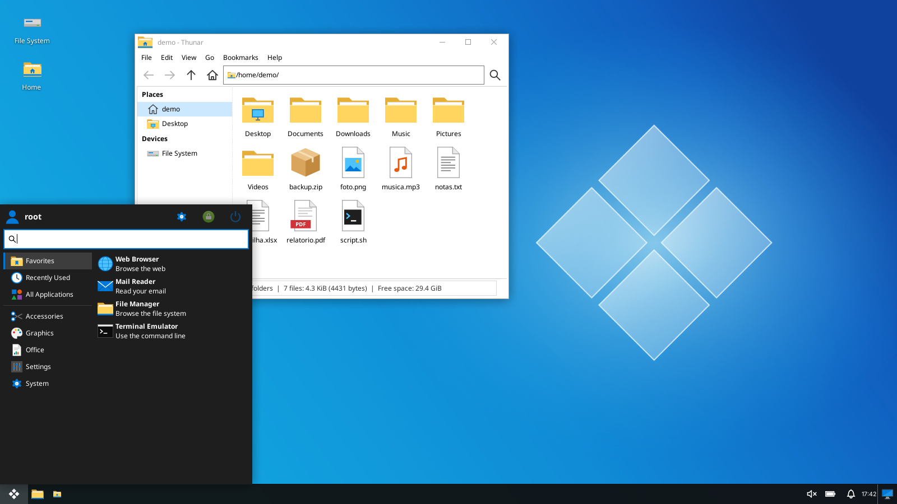
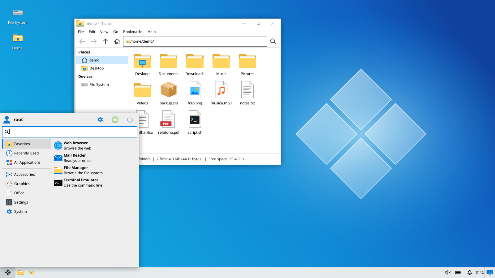
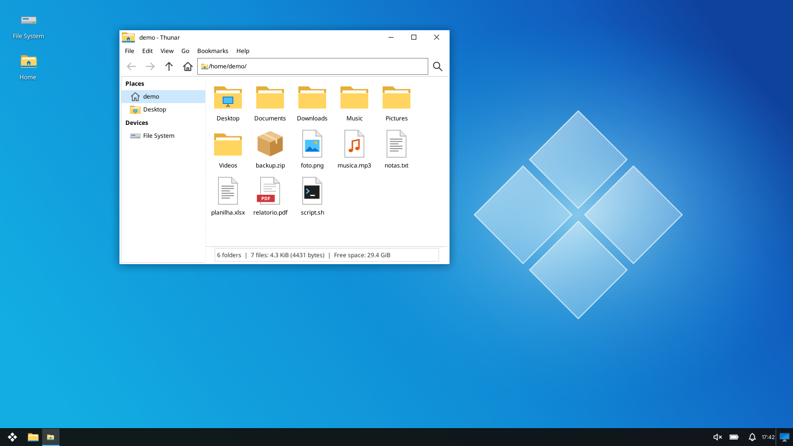
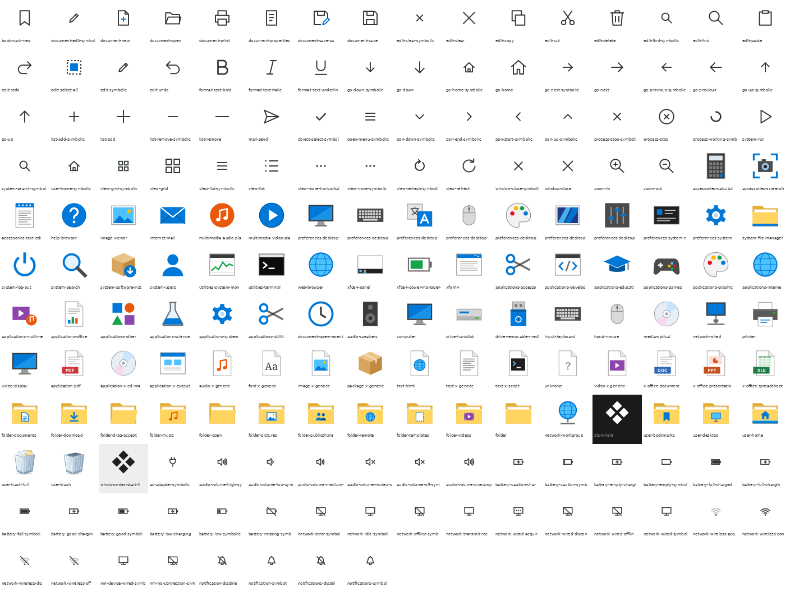
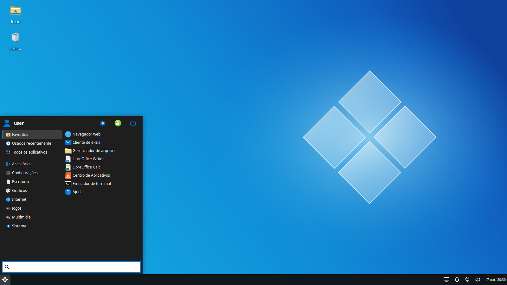
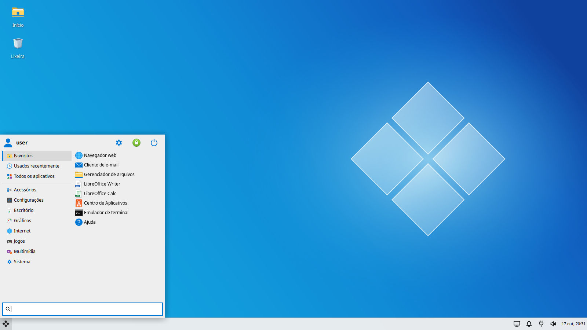
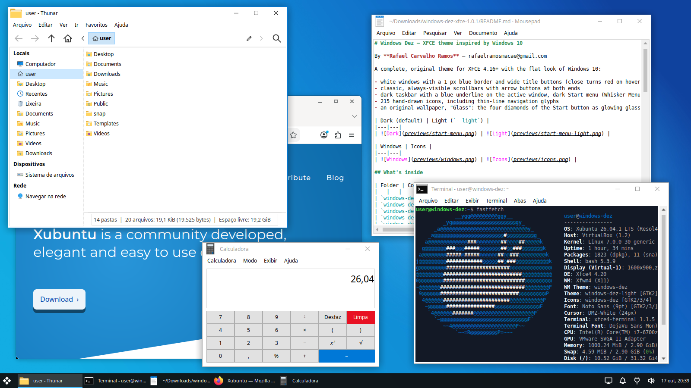
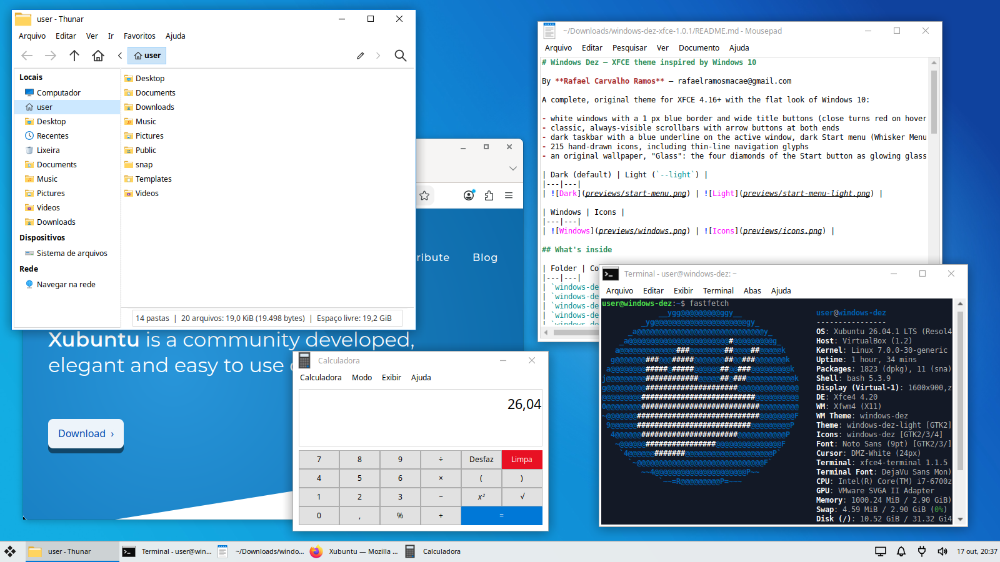

# Windows Dez — XFCE theme inspired by Windows 10

By **Rafael Carvalho Ramos** — rafaelramosmacae@gmail.com

A complete, original theme for XFCE 4.16+ with the flat look of Windows 10:

- white windows with a 1 px blue border and wide title buttons (close turns red on hover)
- classic, always-visible scrollbars with arrow buttons at both ends
- dark taskbar with a blue underline on the active window, dark Start menu (Whisker Menu) and dark notifications — or the same in **light**, like Windows 10 light mode
- 215 hand-drawn icons, including thin-line navigation glyphs
- an original wallpaper, "Glass": the four diamonds of the Start button as glowing glass panes

| Dark (default) | Light (`--light`) |
|---|---|
|  |  |

| Windows | Icons |
|---|---|
|  |  |

## Screenshots

Xubuntu 26.04 with XFCE 4.20:

| Dark Start menu | Light Start menu |
|---|---|
|  |  |

| Dark taskbar with apps | Light taskbar with apps |
|---|---|
|  |  |

## What's inside

| Folder | Contents |
|---|---|
| `windows-dez/gtk-3.0` | GTK 3 theme: buttons, entries, tabs, lists, menus, switches, scrollbars with arrow buttons, panel and Whisker Menu |
| `windows-dez/gtk-2.0` | Matching colors for legacy GTK 2 applications |
| `windows-dez/xfwm4` | Window borders and buttons (PNG) + `themerc` |
| `windows-dez/xfce-notify-4.0` | Dark notifications in the style of Windows 10 toasts |
| `windows-dez-light` | Same theme with a light taskbar, Start menu and notifications |
| `windows-dez-icons` | 215 SVG icons drawn from scratch + 386 aliases (folders, devices, XFCE apps, menu categories, file types, actions, symbolic navigation and system-tray icons) |
| `wallpaper` | Original "Glass" wallpaper — four glass diamonds on a cyan to royal-blue gradient (1080p and 4K) |
| `build` | Python scripts that generate the icons, window borders, wallpaper and the light variant (`variants.py` + `light.css`) |

## Installation

```bash
tar xzf windows-dez-xfce-1.0.1.tar.gz
cd windows-dez-xfce-1.0.1
./install.sh --full            # dark taskbar and Start menu (default)
./install.sh --full --light    # light taskbar and Start menu
```

Log out and back in afterwards so every application picks up the theme.
You can switch between the styles at any time by running `./install.sh --light` or `./install.sh --dark` again.

### Installer options

| Option | What it does |
|---|---|
| *(none)* | Installs and applies the GTK theme, icons, window borders, notifications and font, and turns off overlay scrollbars so the classic scrollbars are always visible |
| `--dark` | Dark taskbar, Start menu and notifications (default) |
| `--light` | Light taskbar, Start menu and notifications |
| `--taskbar` | Moves panel 1 to the bottom (33 px, full width), sets the Start button icon without a label, makes the window list icon-only, puts the Start menu categories on the left, switching them on hover, and lets you reorder taskbar buttons by drag-and-drop |
| `--wallpaper` | Applies the theme wallpaper on every monitor |
| `--wallpaper=FILE` | Applies your own image (jpg/png) on every monitor |
| `--start-icon=FILE` | Uses your own image (svg/png) for the Start button |
| `--full` / `--complete` | `--taskbar` + `--wallpaper`, plus smaller desktop icons (36 px) and icon tooltips (48 px) |
| `--system` | Installs for all users in `/usr/share` (run with `sudo`) |
| `--no-apply` | Only copies the files; pick the theme yourself in *Settings › Appearance* and *Window Manager* |

The installer saves your previous settings to `~/.config/windows-dez/backup.tsv`. To go back to how things were:

```bash
./uninstall.sh            # or: sudo ./uninstall.sh --system
```

### Using your own images

```bash
./install.sh --full --wallpaper=~/Pictures/my-wallpaper.jpg --start-icon=~/Pictures/my-start.svg
```

Images are copied into the theme folders, so they keep working even if you delete the originals; `uninstall.sh` removes them too. For the Start button, use an SVG or a PNG of at least 48×48 px with a transparent background and a light design (the taskbar is dark).

## Getting closer to Windows 10

- **Panel layout:** Whisker Menu · Launchers · Window Buttons · Separator (expand) · Notification Area · Clock · Show Desktop. Set it up in *Settings › Panel › Items*.
- **Whisker Menu:** install `xfce4-whiskermenu-plugin` if you don't have it. The *Docklike Taskbar* plugin (`xfce4-docklike-plugin`) is styled too.
- **Compositing:** enable it in *Window Manager Tweaks › Compositor* for window shadows and a translucent taskbar.
- **Font:** the installer uses *Segoe UI* if it is installed, otherwise *Noto Sans* or *Open Sans*, at size 9.

## Notes

- Tested on XFCE 4.18 and on Xubuntu 26.04 with XFCE 4.20 (xfwm4, xfce4-panel, Thunar, Mousepad, Whisker Menu); the CSS is validated with GTK 3's own parser.
- The icons need GTK's SVG loader (`librsvg2-common` on Debian/Ubuntu, `librsvg2` on Fedora, `librsvg` on Arch), which virtually every distribution ships.
- GTK 4/libadwaita (GNOME) apps and Snap apps such as Firefox on Ubuntu ignore GTK themes and keep their own look.
- Tray icons come from the inherited Adwaita theme; they are symbolic and turn white on the dark taskbar.

## Author

**Rafael Carvalho Ramos**  
rafaelramosmacae@gmail.com

Bug reports, suggestions and contributions are welcome by e-mail.

## Credits and license

All artwork in this package — icons, glyphs, window borders, CSS and wallpaper — is original and released under the **GNU General Public License v3.0 or later** (see `LICENSE`).

Copyright © 2026 Rafael Carvalho Ramos <rafaelramosmacae@gmail.com>

"Windows" is a trademark of Microsoft Corporation. This project is not affiliated with or endorsed by Microsoft; the name only describes the visual inspiration. No Microsoft logos or artwork are included.
